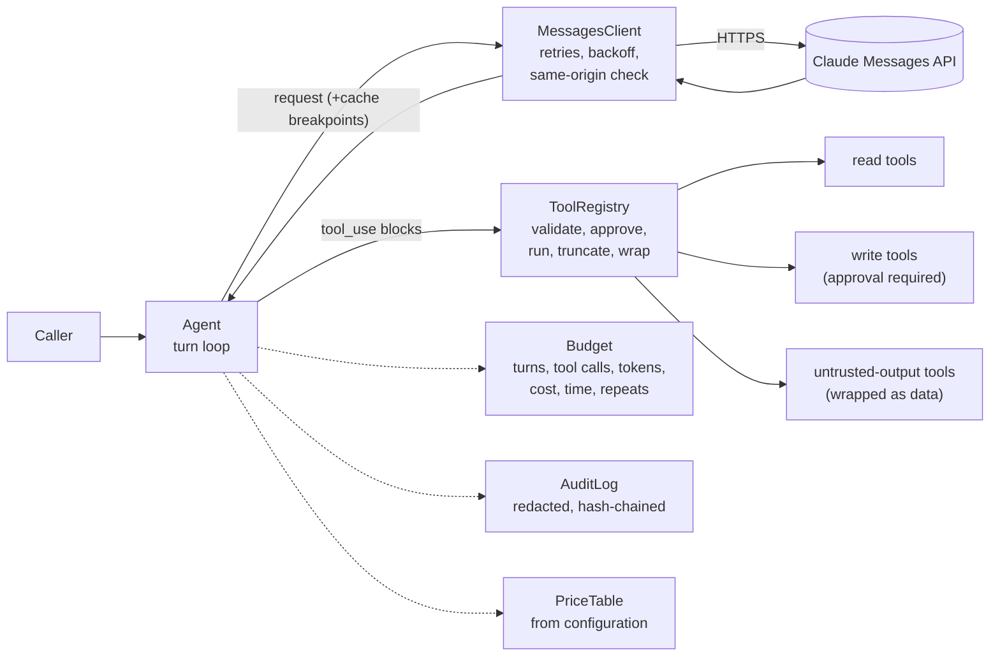
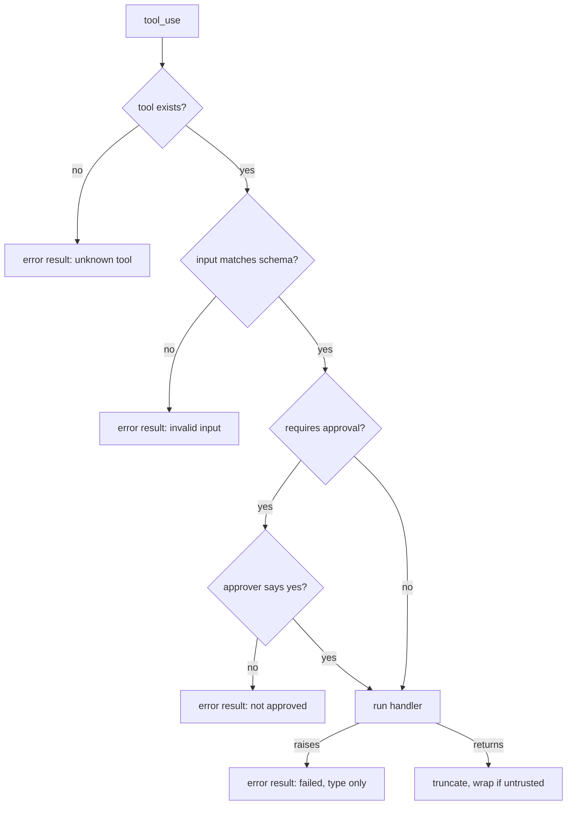

# Architecture

The package is small enough to read in one sitting. Each module has one job.

| Module | Responsibility |
|---|---|
| `transport.py` | The only code that touches the network. A two-method interface, so tests and evals replace it completely. |
| `client.py` | Request headers, error parsing, retry policy, and a check that credentials only go to `base_url`. |
| `agent.py` | The loop. Decides when to stop, never raises for a bad tool call, always answers every `tool_use` id. |
| `tools.py`, `schema.py` | Registers tools, validates model-produced input, gates side effects, bounds and labels output. |
| `budget.py` | Six hard limits, checked before every model call. |
| `caching.py` | Applies cache breakpoints to a copy of each request. |
| `cost.py` | Turns usage into dollars using a price table you supply. |
| `audit.py` | Redaction and the hash-chained event log. |
| `batches.py` | Message Batches for work nobody is waiting on. |
| `evals.py` | Scripted transport and the scenario runner. |

## One turn of the loop

1. Check the budget. If any limit is reached, stop and say which one.
2. Build the request. Add cache breakpoints to a copy, so the stored history stays clean.
3. Send it through the client. Transient failures retry with jittered backoff; the rest raise.
4. Record usage and cost, emit an audit event, append the assistant's blocks **unchanged**.
5. Look at `stop_reason`:
   - `end_turn` or `stop_sequence`: finished.
   - `tool_use`: run every requested tool and send one `user` message of results, `tool_result`
     blocks first. Then go to step 1.
   - `pause_turn`: send the history back as it is and continue.
   - `max_tokens`: stop. A tool call cut off mid-way is **not** executed.
   - `refusal`: stop. Not retried.
   - anything else: stop and report it, rather than guess.

## How a tool call is handled

Every branch produces a result the model can read. Nothing is silently dropped, and nothing
the model says can skip a step.

## What is intentionally not here

- **Streaming.** Responses are requested whole. Long generations should be streamed in a real
  service, which changes the retry story; see [operations](operations.md).
- **Provider abstraction.** This is a reference for one API, written to be understood.
- **Memory, planning and multi-agent orchestration.** They sit above this loop and need the
  same limits, approvals and audit trail that it provides.
